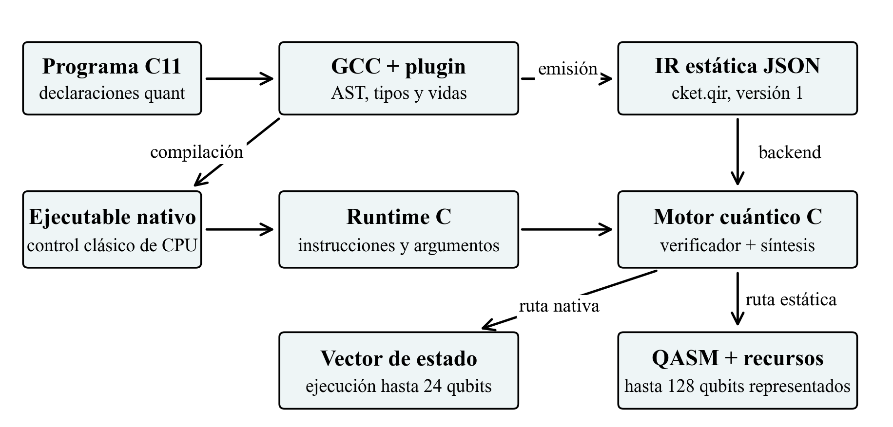
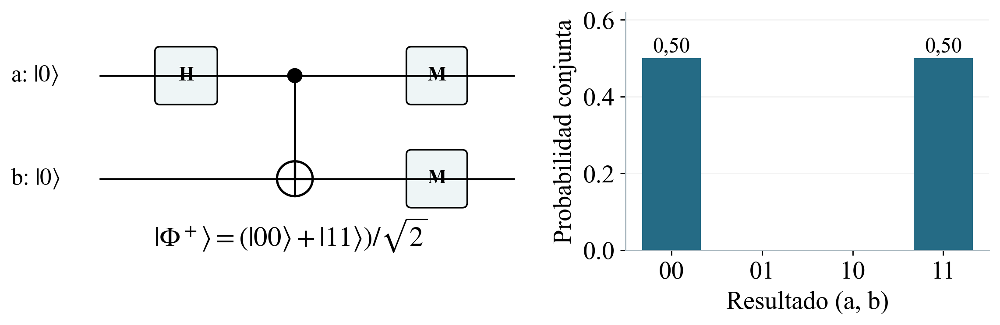
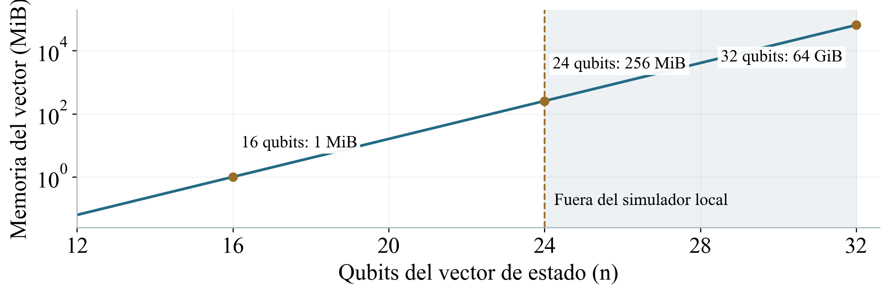
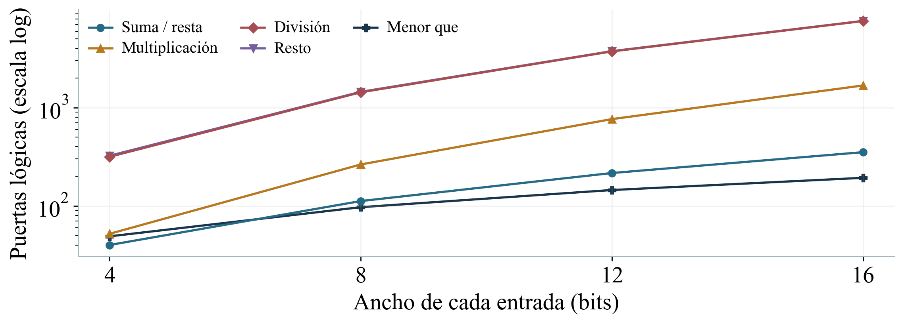

# C Ket: programación cuántica en C

<!-- authors -->
**Ignacio Schwindt**

<!-- /authors -->

## Resumen

Presentamos C Ket, un sistema experimental de programación cuántica integrado en C11 mediante un plugin de GCC. El sistema combina expresiones enteras y control coherente con ejecución clásica nativa. Su arquitectura comprende análisis de propiedad, una representación intermedia JSON, síntesis reversible y exportación OpenQASM 3. La conservación explícita de dependencias permite descomputar registros temporales y distingue transferencia de propiedad, préstamo y medición. La evaluación comprende 354 pruebas nativas, 426 comprobaciones de 16 programas, 145 compilaciones diferenciales, 24 circuitos sintetizados sin tablas y 11 validaciones independientes con QuEST. Analizamos el número de puertas y los registros auxiliares de seis operadores con anchos entre 4 y 16 bits. La representación de circuitos admite 128 qubits y la simulación local hasta 24. Los resultados caracterizan la implementación y muestran que el costo de los auxiliares limita la simulación de circuitos que sí pueden sintetizarse.

## 1 Introducción

Expresar un algoritmo cuántico requiere coordinar transformaciones reversibles, resultados probabilísticos y trabajo clásico. Las expresiones familiares de un lenguaje de propósito general no conservan automáticamente esas propiedades: sobrescribir una entrada o descartar un temporal puede destruir información necesaria para invertir el cálculo. La medición, además, cambia el estado y debe tener un lugar explícito en el programa.

C Ket explora esta integración desde C11 [1]. El programador declara datos con `quant`, utiliza expresiones enteras y construcciones de control reconocibles, mientras GCC sigue compilando el trabajo de CPU. Un plugin analiza el subconjunto cuántico antes de las transformaciones generales del compilador y lo traduce a operaciones verificadas. La ruta nativa enlaza un motor C; otra ruta emite circuitos estáticos y recursos. Esta organización permite estudiar conjuntamente semántica, compilación y costos de representación.

Las contribuciones de este trabajo son una disciplina de propiedad y descomputación integrada en C, un motor común para simulación y exportación, y una evaluación de la síntesis aritmética sin enumeración de dominios en las cargas estudiadas. La integración se limita a un subconjunto de C11: las operaciones cuánticas requieren condiciones de reversibilidad y conservación de dependencias que la semántica clásica, por sí sola, no establece.

El análisis se centra en la relación entre expresividad, conservación de información y costo de síntesis. En particular, estudiamos cómo las dependencias de los cálculos reversibles condicionan la reutilización de auxiliares y cómo esa reutilización afecta los recursos de los circuitos. La evaluación combina pruebas funcionales, contraste con un simulador independiente y medición de recursos lógicos.

## 2 Antecedentes

Bennett estableció un marco para recuperar espacio mediante cálculo reversible y restauración de auxiliares [3]. Silq vincula tipos y descomputación segura en un lenguaje cuántico de alto nivel [6]; Quipper ofrece composición programática de circuitos desde un enfoque funcional [7]. C Ket estudia estas cuestiones mediante su integración con el árbol de sintaxis abstracta de GCC y el control clásico de C. Estos antecedentes sitúan las decisiones de diseño; la evaluación se concentra en la implementación y sus recursos, sin realizar una comparación experimental entre lenguajes.

OpenQASM 3 proporciona un lenguaje de intercambio con controles y fases [8, 9]. La exportación de C Ket utiliza un subconjunto estático, cuya expresividad depende de las construcciones que el frontend puede traducir. QuEST proporciona una implementación independiente para contrastar los estados y canales de los circuitos exportados [10].

## 3 Arquitectura del sistema

La Figura 1 separa las rutas de compilación y ejecución. El plugin está escrito en C++17 y el runtime y motor en C. Ambos caminos utilizan el mismo verificador y sintetizador, aunque la validación externa de QASM emplea una implementación independiente [1].



### 3.1 Frontend y tipos

La declaración `quant` se implementa mediante un atributo de GCC. El plugin interviene en `PLUGIN_PRE_GENERICIZE` para analizar declaraciones, expresiones y tiempos de vida [2]. Los enteros conservan su ancho, interpretación con o sin signo y conversiones explícitas. La aritmética sin signo utiliza reducción modular; las expresiones con signo requieren satisfacer sus condiciones de validez. El siguiente programa ilustra el cálculo y la medición del valor 12:

```c
#include <quantum.h>
#include <stdio.h>
int main(void) {
    quant uint8_t value = 7;
    value += 5;
    printf("%u\n", (unsigned)measure(value));
    return 0;
}
```

### 3.2 Propiedad y descomputación

Una inicialización directa entre registros compatibles transfiere propiedad; una expresión nueva preserva las entradas y produce un resultado correlacionado. Los préstamos permiten operar sin transferir el registro. Conceptualmente, el cálculo reversible acumula una función en un destino:

$$
U_f|x\rangle|y\rangle=|x\rangle|y\oplus f(x)\rangle.
$$


La operación `qcompute` registra la expresión, los controles normalizados y las versiones de sus dependencias. La operación inversa, `quncompute`, requiere que esos elementos permanezcan compatibles. Modificar, medir o liberar una dependencia puede impedir la descomputación. El criterio de identidad de expresiones es conservador y se basa en su representación JSON. Antes de reutilizar un auxiliar, el simulador exige una probabilidad residual fuera del estado cero inferior a `1e-10`. La liberación de temporales sigue el orden inverso de sus dependencias [1, 3].

### 3.3 Control coherente y transformadas

Una condición cuántica controla operaciones unitarias. En el ejemplo siguiente, Fourier sobre un bit equivale a H y el XOR controlado crea el estado de Bell de la Figura 3. Las mediciones posteriores conservan su correlación.

```c
quant bool a = 0, b = 0;
fourier(a);
if (a) b ^= 1;
unsigned first = measure(a), second = measure(b);
```



Bajo control cuántico se rechazan I/O, efectos de CPU, medición y reset. Fourier usa exponente positivo, little-endian y síntesis cuadrática en el ancho; su inversa cambia el signo. Los bucles de CPU siguen siendo clásicos. La exportación expande formas fijas admitidas hasta 4096 iteraciones; las declaraciones cuánticas en bucles dinámicos y los bucles coherentes generales tienen restricciones.

### 3.4 IR verificada y síntesis

`cket.qir`, versión 1, es una IR propia en JSON. El verificador comprueba campos, tipos, aridades, conversiones, controles y disponibilidad de registros. No es LLVM QIR. Esta instrucción aislada calcula una suma de 8 bits; requiere registros existentes y un destino limpio [1]:

```json
{"op": "qcompute", "id": 1, "expr": {
  "op": "add", "bits": 8, "signed": false, "args": [
    {"op": "reg", "id": 0, "bits": 8, "signed": false},
    {"op": "const", "bits": 8, "signed": false, "value": 5}
  ]}}
```

El motor combina síntesis simbólica, circuitos aritméticos con registros auxiliares reversibles y enumeración finita de hasta 12 bits relevantes. La opción `--no-tables` permite evaluar la síntesis sin enumeración. División y resto requieren demostrar que el divisor es distinto de cero. Los límites de recursos determinan cuándo se rechaza una expresión. En la ejecución nativa, un circuito puede sintetizarse durante su primera invocación y reutilizarse mediante una caché.

### 3.5 Búsqueda y amplificación

El algoritmo de Grover reduce el número de consultas al oráculo en búsqueda no estructurada [4]. C Ket sintetiza ese oráculo a partir de un predicado puro. La operación `find` requiere una única solución; `find_known` utiliza un número M de soluciones proporcionado como precondición. Ambas operaciones requieren una preparación uniforme sin modificar y transfieren la propiedad del registro de entrada [1].

```c
quant uint8_t x = superposition(0, 15);
quant uint8_t answer = find(x, x * x == 9);
printf("%u\n", (unsigned)measure(answer));
```

Para N candidatos y M soluciones, la probabilidad ideal tras r iteraciones es [5]:

$$
\theta=\arcsin\sqrt{M/N},\qquad P_r=\sin^2((2r+1)\theta).
$$


El ejemplo devuelve 3 con probabilidad ideal cercana al 96,13 %. Cuando el número de soluciones es desconocido, `search` combina muestreo, amplificación, medición y verificación clásica. Un resultado falso indica que se agotó el presupuesto de búsqueda. La cota de fallo especificada para esta operación, `(7/8)^attempts`, presupone la existencia de una solución y aleatoriedad uniforme independiente; su alcance se limita a esas condiciones de ejecución [1, 5].

## 4 Motivación y costos del modelo

La integración con C conserva trabajo de CPU y permite concentrar los recursos cuánticos en registros y oráculos. La propiedad explícita evita resolver descartes mediante mediciones ocultas; recuperar auxiliares reduce nuevas asignaciones. Estas decisiones tienen costos: preservar entradas, construir destinos e invertir trabajo aumenta puertas y workspace. La expresión de alto nivel no determina por sí sola el costo físico.

El simulador usa amplitudes `double complex` y evoluciona unitariamente hasta una medición de Born. En la representación de referencia, el vector ocupa:

$$
B(n)=16\cdot 2^n\ \mathrm{bytes}.
$$



<!-- table: Tabla 1. Capacidades del prototipo: ancho del tipo, representación de circuitos y simulación son límites distintos. -->
| Capacidad | Límite |
|---|---|
| Entero cuántico | 64 bits de representación |
| Circuito almacenado y exportado | 128 qubits representados |
| Vector de estado local | 24 qubits físicos |

Los qubits auxiliares contribuyen al tamaño del vector de estado. Una distribución inicial con pocos estados de amplitud no nula conserva la dimensión asociada al ancho declarado. Asimismo, reutilizar qubits restaurados no reduce una dimensión ya alcanzada. La capacidad de representar y exportar circuitos debe, por tanto, distinguirse de la capacidad de simular sus amplitudes.

## 5 Configuración experimental

### 5.1 Implementación y entorno

La evaluación corresponde a C Ket 0.4.0 [1], compilado con GCC 11.4.0 en Ubuntu 22.04 sobre WSL2 x86_64. Todas las campañas utilizan la misma revisión de la implementación. Se consideran por separado la corrección funcional, la concordancia con una implementación independiente y el costo lógico de los circuitos sintetizados.

### 5.2 Cargas y criterios

Las pruebas del frontend y de los programas utilizan cinco niveles de optimización: `-O0`, `-O1`, `-O2`, `-O3` y `-Os`. Se fijan las semillas 20261011 para generación y 7 para ejecución. La evaluación de recursos comprende seis operadores y cuatro anchos, con dos entradas sin signo preparadas uniformemente y un registro de resultado. En división y resto, el divisor se combina mediante OR con uno para excluir el valor cero. Los conteos incluyen preparación y descomputación de auxiliares privados; el resultado final se conserva.

## 6 Resultados

### 6.1 Corrección observada y validación externa

La Tabla 2 presenta los resultados de validación según la unidad de cada campaña. Las 145 compilaciones corresponden a 29 casos evaluados en cinco niveles de optimización. Las pruebas nativas incluyen conjuntos de 1024 expresiones generadas y 4096 mutaciones de la representación intermedia, contabilizados dentro de casos agregados [1]. Estas cantidades describen dimensiones diferentes de la evaluación y se interpretan por separado.

<!-- table: Tabla 2. Resultados de validación de la implementación evaluada. Todas las campañas finalizaron sin fallos en los casos examinados. -->
| Campaña | Resultado | Alcance |
|---|---|---|
| Nativa | 354 pruebas | Semántica, estados, errores y CLI |
| Ejemplos | 426 comprobaciones | 16 programas, cinco niveles |
| Frontend diferencial | 145 compilaciones | Casos fijos y generados |
| Síntesis sin tablas | 24 circuitos | Seis operadores, cuatro anchos |
| QASM con QuEST | 11 circuitos | Ocho estados y tres canales |

Un lector independiente ejecuta los circuitos exportados en QuEST 3.7.0 [10]. Ocho casos comparan amplitudes salvo una fase global común y probabilidades con tolerancia `1e-10`. Tres canales con medición intermedia y reinicio contrastan secuencias de resultados mediante 8192 ejecuciones por circuito e implementación. Además, se comprueba el rechazo de ocho circuitos malformados. El lector implementa el subconjunto OpenQASM utilizado por el exportador.

### 6.2 Puertas lógicas



<!-- table: Tabla 3. Número de puertas lógicas por operador y ancho w de cada registro de entrada. -->
| Operador | w=4 | w=8 | w=12 | w=16 |
|---|---|---|---|---|
| Suma | 40 | 112 | 216 | 352 |
| Resta | 40 | 112 | 216 | 352 |
| Multiplicación | 52 | 264 | 764 | 1680 |
| División | 316 | 1432 | 3732 | 7600 |
| Resto | 324 | 1448 | 3756 | 7632 |
| Menor que | 49 | 97 | 145 | 193 |

A 16 bits, la comparación requiere 193 puertas y el resto 7632. Cada MCX se cuenta como una puerta lógica antes de descomposición. Los conteos describen costos relativos del sintetizador; no incluyen tiempos de ejecución ni descomposición física.

### 6.3 Registros auxiliares y profundidad


<!-- table: Tabla 4. Recursos lógicos para w=16. Auxiliares y pico se expresan en qubits; la profundidad corresponde a las dependencias del circuito antes del mapeo físico. -->
| Operador | Puertas | Auxiliares | Pico de qubits | Profundidad lógica |
|---|---|---|---|---|
| Suma | 352 | 16 | 64 | 246 |
| Resta | 352 | 16 | 64 | 276 |
| Multiplicación | 1680 | 16 | 64 | 1634 |
| División | 7600 | 50 | 98 | 5538 |
| Resto | 7632 | 66 | 114 | 5540 |
| Menor que | 193 | 17 | 50 | 41 |

Las dos entradas y el resultado de suma, resta y multiplicación ocupan 48 qubits; los auxiliares elevan el pico a 64. El resto alcanza 114. Los circuitos de 50 a 114 qubits se analizan por síntesis y contabilización. La profundidad mide dependencias lógicas. Su diferencia entre suma y resta, con igual número de puertas, refleja diferencias de paralelismo.

Con 8, 16, 24 y 32 bits relevantes, las cargas superan el límite de enumeración de 12 bits. La representación de enteros de 64 bits no garantiza síntesis dentro del presupuesto disponible: la división de ese ancho requiere más auxiliares de los admitidos.

### 6.4 Amenazas a la validez y restricciones

La evaluación utiliza una versión de GCC y cargas finitas. La simulación emplea punto flotante sin cota global del error acumulado. Compartir el motor de ejecución y exportación puede correlacionar errores. QuEST reduce esa dependencia en los casos contrastados, sin constituir una demostración formal.

El análisis de flujo no cubre todos los caminos de C. Se restringen recursión, llamadas indirectas, composición entre unidades y retornos de productos. No se admiten flotantes cuánticos generales, VLAs, unions, bitfields ni asignación dinámica cuántica. Los módulos unitarios requieren préstamos tipados y auxiliares restaurados, sin constituir una ABI general.

Se estudian circuitos ideales, sin ejecución en procesadores cuánticos, ruido, corrección de errores ni conectividad física. El acceso a amplitudes completas sirve para validación en simulación y no es una operación de hardware [1].

<!-- page -->

## 7 Conclusiones

C Ket integra declaraciones cuánticas, cálculo reversible y control clásico en un subconjunto de C11. La disciplina de propiedad y la conservación de dependencias permiten restaurar registros temporales, mientras un motor compartido conecta la ejecución híbrida con la exportación de circuitos. La validación funcional y el contraste independiente aportan evidencia de concordancia dentro de las cargas evaluadas.

El análisis de recursos muestra que la expresividad de los operadores debe evaluarse conjuntamente con sus necesidades de auxiliares. División y resto presentan los mayores costos de las familias estudiadas, y varios circuitos sintetizables exceden la capacidad del simulador. La distinción entre representación, síntesis y simulación es, por ello, esencial para interpretar el alcance del sistema.

El objetivo a largo plazo es una semántica cuántica explícita para todas las construcciones de C11 e interfaces de su biblioteca estándar. El trabajo futuro distingue implementaciones pendientes, cotas de recursos e incompatibilidades semánticas justificadas. Flujo, memoria, tipos numéricos y composición entre unidades requieren validación por etapas. La estabilidad de GCC, la descomposición física y las comparaciones con cargas y tiempos equivalentes complementarían los recursos lógicos presentados.


## Referencias

[1] Schwindt, I. *C Ket: C with high-level quantum data*. Versión 0.4.0, 2026. [Software](https://github.com/igna-s/cket).

[2] Free Software Foundation. *GNU Compiler Collection Internals: Plugin API*. Documentación oficial, consulta: 11 de octubre de 2026. [API de plugins de GCC](https://gcc.gnu.org/onlinedocs/gccint/Plugin-API.html).

[3] Bennett, C. H. Logical Reversibility of Computation. *IBM Journal of Research and Development*, 17(6):525-532, 1973. DOI: 10.1147/rd.176.0525. [Artículo original](https://doi.org/10.1147/rd.176.0525).

[4] Grover, L. K. A fast quantum mechanical algorithm for database search. *STOC*, pp. 212-219, 1996. arXiv:quant-ph/9605043. [Preprint](https://arxiv.org/abs/quant-ph/9605043).

[5] Boyer, M., Brassard, G., Høyer, P., y Tapp, A. Tight bounds on quantum searching. *Fortschritte der Physik*, 46, 1998; preprint 1996. arXiv:quant-ph/9605034. [Preprint](https://arxiv.org/abs/quant-ph/9605034).

[6] Bichsel, B., Baader, M., Gehr, T., y Vechev, M. Silq: A High-Level Quantum Language with Safe Uncomputation and Intuitive Semantics. *PLDI*, pp. 286-300, 2020. DOI: 10.1145/3385412.3386007. [Versión de autores, ampliada](https://files.sri.inf.ethz.ch/website/papers/pldi20-silq.pdf).

[7] Green, A. S., Lumsdaine, P. L., Ross, N. J., Selinger, P., y Valiron, B. Quipper: A Scalable Quantum Programming Language. *ACM SIGPLAN Notices*, 48(6):333-342, 2013. [Preprint](https://arxiv.org/abs/1304.3390).

[8] Cross, A. W., et al. OpenQASM 3: A broader and deeper quantum assembly language. *ACM Transactions on Quantum Computing*, 3(3), 2022. DOI: 10.1145/3505636. [Preprint](https://arxiv.org/abs/2104.14722).

[9] OpenQASM. *OpenQASM 3.0 Specification: Gates*. Especificación oficial, consulta: 11 de octubre de 2026. [Controles y fases](https://openqasm.com/versions/3.0/language/gates.html).

[10] Jones, T., Brown, A., Bush, I., y Benjamin, S. C. QuEST and High Performance Simulation of Quantum Computers. *Scientific Reports*, 9:10736, 2019. DOI: 10.1038/s41598-019-47174-9. [Preprint](https://arxiv.org/abs/1802.08032).
