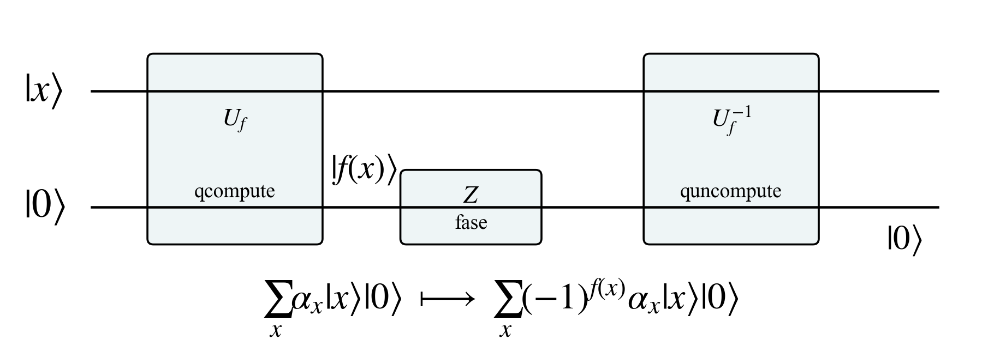
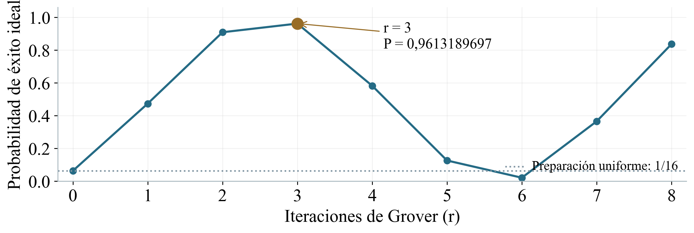
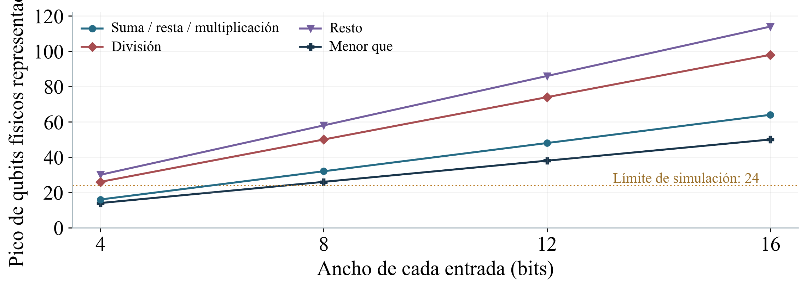

# C Ket: programación cuántica en C

<!-- authors -->
**Ignacio Schwindt**

Proyecto C Ket (|c> / cket)
<!-- /authors -->

## Resumen

C Ket es un prototipo de programación cuántica de alto nivel integrado en C11 mediante un plugin de GCC. Permite declarar enteros cuánticos, expresar cálculos y condiciones coherentes y combinar circuitos con control clásico nativo. Su arquitectura reúne un frontend con análisis de propiedad, una representación intermedia JSON verificada, síntesis reversible, un runtime C y exportación OpenQASM 3. El sistema exige conservar las dependencias necesarias para descomputar temporales y distingue transferencia de propiedad, préstamo y medición. Evaluamos una revisión fijada mediante 354 pruebas nativas, 426 comprobaciones de 16 ejemplos, 145 compilaciones diferenciales, 24 circuitos sin tablas y 11 validaciones independientes con QuEST. Presentamos costos de puertas y workspace para seis operadores entre 4 y 16 bits. La representación admite 128 qubits y el simulador local 24; estas capacidades son diferentes. Los resultados documentan el subconjunto implementado y sus límites, sin afirmar ventaja práctica, ejecución en hardware ni corrección formal general.

## 1 Introducción

Expresar un algoritmo cuántico requiere coordinar transformaciones reversibles, resultados probabilísticos y trabajo clásico. Las expresiones familiares de un lenguaje de propósito general no conservan automáticamente esas propiedades: sobrescribir una entrada o descartar un temporal puede destruir información necesaria para invertir el cálculo. La medición, además, cambia el estado y debe tener un lugar explícito en el programa.

C Ket explora esta integración desde C11 [1]. El programador declara datos con `quant`, utiliza expresiones enteras y construcciones de control reconocibles, mientras GCC sigue compilando el trabajo de CPU. Un plugin analiza el subconjunto cuántico antes de las transformaciones generales del compilador y lo traduce a operaciones verificadas. La ruta nativa enlaza un motor C; otra ruta emite circuitos estáticos y recursos. Esta organización permite estudiar conjuntamente semántica, compilación y costos de representación.

El aporte del proyecto se concreta en tres elementos: una disciplina explícita de propiedad y descomputación; un motor compartido por simulación y exportación; y evidencia reproducible de aceptación, rechazo y síntesis aritmética sin enumerar dominios en las cargas evaluadas. Su alcance es experimental. C Ket no implementa todo C11 para datos cuánticos, y conservar la sintaxis de C no garantiza que cualquier programa clásico admita una traducción coherente.

El artículo presenta antecedentes, arquitectura y motivación del modelo; describe el entorno experimental y sus resultados; y delimita las conclusiones. Las figuras distinguen esquemas, cálculos ideales y datos de síntesis. La evaluación corresponde a cket 0.4.0 y a la revisión identificada en la Sección 5, para evitar mezclar mediciones de estados diferentes del proyecto.

<!-- page -->

## 2 Antecedentes

Bennett estableció un marco para recuperar espacio mediante cálculo reversible y restauración de auxiliares [3]. Silq vincula tipos y descomputación segura en un lenguaje cuántico de alto nivel [6]; Quipper ofrece composición programática de circuitos desde un enfoque funcional [7]. C Ket participa de esa línea e investiga su integración con el AST de GCC y el control clásico de C. La comparación es arquitectónica: no se midió productividad ni rendimiento equivalente frente a esos lenguajes.

OpenQASM 3 proporciona un lenguaje de intercambio con controles y fases [8, 9]. C Ket exporta un subconjunto estático; sus restricciones de CPU no son restricciones generales del estándar. QuEST aporta una implementación externa para contrastar los circuitos exportados [10]. Estos componentes cumplen funciones distintas: frontend, intercambio y referencia de simulación.

## 3 Arquitectura del sistema

La Figura 1 separa las rutas de compilación y ejecución. El plugin está escrito en C++17 y el runtime y motor en C. Ambos caminos utilizan el mismo verificador y sintetizador, aunque la validación externa de QASM emplea una implementación independiente [1].


### 3.1 Frontend y tipos

`quant` es una macro de atributo de GCC, no un parser separado. El plugin utiliza `PLUGIN_PRE_GENERICIZE` para inspeccionar declaraciones, expresiones y vidas [2]. Los enteros conservan ancho, signedness y conversiones explícitas. La aritmética unsigned respeta reducción modular; las expresiones con signo quedan sujetas a sus condiciones de validez. El siguiente programa completo calcula y mide 12:

```c
#include <quantum.h>
#include <stdio.h>
int main(void) {
    quant uint8_t value = 7;
    value += 5;
    printf("%u\n", (unsigned)measure(value));
    return 0;
}
```

<!-- page -->

### 3.2 Propiedad y descomputación

Una inicialización directa entre registros compatibles transfiere propiedad; una expresión nueva preserva las entradas y produce un resultado correlacionado. Los préstamos permiten operar sin transferir el registro. Conceptualmente, el cálculo reversible acumula una función en un destino:

$$
U_f|x\rangle|y\rangle=|x\rangle|y\oplus f(x)\rangle.
$$



Cada `qcompute` certifica expresión JSON, controles normalizados y versiones de dependencias. `quncompute` exige compatibilidad; mutar, medir o liberar una dependencia puede invalidar la inversa. La igualdad textual de JSON es conservadora y no resuelve equivalencia matemática general. La simulación exige residuo fuera de cero menor que `1e-10` antes de reutilizar el auxiliar. La limpieza elegible sigue el orden inverso de dependencias [1, 3].

### 3.3 Control coherente y transformadas

Una condición cuántica controla operaciones unitarias. En el ejemplo siguiente, Fourier sobre un bit equivale a H y el XOR controlado crea el estado de Bell de la Figura 3. Las mediciones posteriores conservan su correlación.

```c
quant bool a = 0, b = 0;
fourier(a);
if (a) b ^= 1;
unsigned first = measure(a), second = measure(b);
```


Bajo control cuántico se rechazan I/O, efectos de CPU, medición y reset. Fourier usa exponente positivo, little-endian y síntesis cuadrática en el ancho; su inversa cambia el signo. Los bucles de CPU siguen siendo clásicos. La exportación expande formas fijas admitidas hasta 4096 iteraciones; las declaraciones cuánticas en bucles dinámicos y los bucles coherentes generales tienen restricciones.

<!-- page -->

### 3.4 IR verificada y síntesis

`cket.qir`, versión 1, es una IR propia en JSON. El verificador comprueba campos, tipos, aridades, conversiones, controles y disponibilidad de registros. No es LLVM QIR. Esta instrucción aislada calcula una suma de 8 bits; requiere registros existentes y un destino limpio [1]:

```json
{"op": "qcompute", "id": 1, "expr": {
  "op": "add", "bits": 8, "signed": false, "args": [
    {"op": "reg", "id": 0, "bits": 8, "signed": false},
    {"op": "const", "bits": 8, "signed": false, "value": 5}
  ]}}
```

El motor combina síntesis simbólica, circuitos aritméticos con workspace reversible y una alternativa finita de hasta 12 bits relevantes. `--no-tables` desactiva esta última. División y resto necesitan un divisor no nulo probado. Los presupuestos producen diagnósticos, sin asegurar síntesis eficiente para toda expresión. En la ruta nativa, una primera llamada puede sintetizar y alimentar una caché; eso no implica compilación anticipada general.

### 3.5 Búsqueda y amplificación

Grover reduce el número de consultas a un oráculo para búsqueda no estructurada [4]. C Ket construye el oráculo desde un predicado puro; su síntesis también tiene costo. `find` exige una solución y `find_known` recibe un conteo M prometido por el llamador. Ambas operaciones necesitan preparación uniforme intacta y transfieren propiedad [1].

```c
quant uint8_t x = superposition(0, 15);
quant uint8_t answer = find(x, x * x == 9);
printf("%u\n", (unsigned)measure(answer));
```

Para N candidatos y M soluciones, la probabilidad ideal tras r iteraciones es [5]:

$$
\theta=\arcsin\sqrt{M/N},\qquad P_r=\sin^2((2r+1)\theta).
$$



El ejemplo devuelve 3 con probabilidad ideal cercana al 96,13 %, sin garantía determinista. Para conteo desconocido, `search` mezcla muestreo y Grover con medición y verificación clásica; false significa presupuesto agotado. Su cota documentada `(7/8)^attempts` supone que existe solución y aleatoriedad uniforme independiente. Es un contrato del proyecto, no un nuevo teorema ni una atribución literal a BBHT [1, 5].

<!-- page -->

## 4 Motivación y costos del modelo

La integración con C conserva trabajo de CPU y permite concentrar los recursos cuánticos en registros y oráculos. La propiedad explícita evita resolver descartes mediante mediciones ocultas; recuperar auxiliares reduce nuevas asignaciones. Estas decisiones tienen costos: preservar entradas, construir destinos e invertir trabajo aumenta puertas y workspace. La expresión de alto nivel no determina por sí sola el costo físico.

El simulador usa amplitudes `double complex` y evoluciona unitariamente hasta una medición de Born. En la representación de referencia, el vector ocupa:

$$
B(n)=16\cdot 2^n\ \mathrm{bytes}.
$$


<!-- table: Tabla 1. Capacidades del prototipo: ancho del tipo, representación de circuitos y simulación son límites distintos. -->
| Capacidad | Límite |
|---|---|
| Entero cuántico | 64 bits de representación |
| Circuito almacenado y exportado | 128 qubits representados |
| Vector de estado local | 24 qubits físicos |

Los auxiliares cuentan para la simulación. Un soporte inicial pequeño no elimina los bits del ancho declarado; reutilizar wires limpios tampoco reduce una dimensión del vector ya alcanzada. Exportar un circuito grande no implica simularlo ni ejecutarlo en una QPU.

## 5 Configuración experimental

### 5.1 Revisión y entorno

Se evalúa el commit `1ebb2e308e61bed5632798ded5beecf77b6b9a9c`, cket 0.4.0 experimental, con GCC 11.4.0 en Ubuntu 22.04, WSL2 x86_64. Logs, CSV y estados se conservan en `docs/paper/evidence/`. Las campañas del estudio se repitieron en ese estado; esta edición reutiliza esa evidencia y vuelve a comprobar los ejemplos del manuscrito.

### 5.2 Cargas y criterios

Las pruebas de frontend y ejemplos usan cinco niveles: `-O0`, `-O1`, `-O2`, `-O3` y `-Os`; semillas 20261011 para generación y 7 para ejecución. El benchmark estudia seis operadores y cuatro anchos, con dos entradas unsigned uniformes y un destino. División y resto aplican OR con uno al divisor para impedir cero. Se incluyen preparación y limpieza privada, pero se conserva el resultado final.

<!-- page -->

## 6 Resultados

### 6.1 Corrección observada y validación externa

La Tabla 2 resume campañas con unidades diferentes; sus cifras no se suman como cobertura homogénea. Las 145 compilaciones representan 29 casos en cinco niveles, no 145 algoritmos. Las campañas internas de 1024 expresiones y 4096 mutaciones forman parte de casos agregados de la suite nativa [1].

<!-- table: Tabla 2. Campañas del estado fijado. Todas aprobaron; cada fila conserva su propia unidad de validación. -->
| Campaña | Resultado | Alcance |
|---|---|---|
| Nativa | 354 pruebas | Semántica, estados, errores y CLI |
| Ejemplos | 426 comprobaciones | 16 programas, cinco niveles |
| Frontend diferencial | 145 compilaciones | Casos fijos y generados |
| Síntesis sin tablas | 24 circuitos | Seis operadores, cuatro anchos |
| QASM con QuEST | 11 circuitos | Ocho estados y tres canales |

Un importer separado ejecuta el QASM en QuEST 3.7.0 [10]. Ocho casos comparan amplitudes hasta fase global y probabilidades con tolerancia `1e-10`; tres canales contrastan transcripciones con 8192 ejecuciones por circuito e implementación. También se rechazan ocho artefactos malformados. El importer cubre el subconjunto emitido, no todo OpenQASM 3.

### 6.2 Puertas lógicas


<!-- table: Tabla 3. Puertas lógicas por operador y ancho de cada entrada w, verificadas contra el CSV. -->
| Operador | w=4 | w=8 | w=12 | w=16 |
|---|---|---|---|---|
| Suma | 40 | 112 | 216 | 352 |
| Resta | 40 | 112 | 216 | 352 |
| Multiplicación | 52 | 264 | 764 | 1680 |
| División | 316 | 1432 | 3732 | 7600 |
| Resto | 324 | 1448 | 3756 | 7632 |
| Menor que | 49 | 97 | 145 | 193 |

A 16 bits, comparación usa 193 puertas y resto 7632. Cada MCX cuenta como una puerta lógica, previa a descomposición. Los datos no prueban optimalidad, complejidad general ni aceleración. No se midieron tiempos de pared.

<!-- page -->

### 6.3 Workspace y profundidad



<!-- table: Tabla 4. Recursos a w=16. Auxiliares y pico son qubits; profundidad es la dependencia lógica de wires, previa a cualquier mapeo físico. -->
| Operador | Puertas | Auxiliares | Pico de qubits | Profundidad lógica |
|---|---|---|---|---|
| Suma | 352 | 16 | 64 | 246 |
| Resta | 352 | 16 | 64 | 276 |
| Multiplicación | 1680 | 16 | 64 | 1634 |
| División | 7600 | 50 | 98 | 5538 |
| Resto | 7632 | 66 | 114 | 5540 |
| Menor que | 193 | 17 | 50 | 41 |

Para suma, resta y multiplicación, dos entradas y un resultado aportan 48 qubits lógicos; el pico total es 64. Resto llega a 114. Los puntos de 50 a 114 qubits se obtienen por síntesis y contabilización, no simulando sus amplitudes. La profundidad no equivale a duración física, T-depth o profundidad transpilada. Suma y resta tienen igual conteo pero diferente profundidad: el total de puertas no basta para describir paralelismo.

Los anchos estudiados implican 8, 16, 24 y 32 bits relevantes de entrada. La construcción sin tablas evidencia que estas familias admitidas superan el fallback de 12 bits. No demuestra soporte universal de 64 bits; división de ese ancho requiere workspace adicional aún no soportado.

### 6.4 Amenazas a la validez y restricciones

La evaluación cubre un único entorno de GCC, programas finitos y precisión de punto flotante sin presupuesto global de error. Compartir un motor entre rutas puede correlacionar fallos; QuEST reduce esa dependencia en los casos contrastados. El marcador interno `volatile` ayuda a preservar accesos frente a optimizaciones, pero sus tests no constituyen prueba formal.

El análisis de flujo y vidas no modela todos los caminos de C. Persisten restricciones de recursión, llamadas indirectas, composición cuántica entre unidades y retornos de productos. No se admiten flotantes cuánticos generales, VLAs, unions, bitfields o asignación dinámica cuántica. Los módulos unitarios `circuit` e `inverse_circuit` remapean préstamos tipados y exigen auxiliares privados limpios; no completan una ABI C cuántica general.

El prototipo no incorpora QPU, ruido, corrección de errores ni mapeo a una topología. `--state` es una herramienta del simulador, sin equivalente como observación libre de hardware. Ningún resultado certifica las metas abiertas de la versión 1.0 [1].

<!-- page -->

## 7 Conclusiones

C Ket implementa una ruta experimental desde datos cuánticos en C11 hasta ejecución híbrida y circuitos verificados. Sus contratos de propiedad y dependencias permiten descomputar temporales dentro del subconjunto admitido. La evaluación reproduce corrección observada y exportación, y cuantifica puertas y workspace de seis familias sin tablas. División y resto resultan especialmente exigentes; varios circuitos construibles exceden la capacidad del simulador. Estos hallazgos no establecen ventaja práctica ni corrección general.

Los próximos pasos incluyen ampliar análisis de flujo y ABI, comparar versiones de GCC y medir costos tras descomposición y tiempos con cargas equivalentes. Fuente del artículo, figuras, datos y auditoría acompañan al checkout. Para repetir la evaluación del estado fijado en Linux o WSL:

```bash
export CC=gcc-11 CXX=g++-11
bash docs/paper/audit_project.sh
```

**Disponibilidad.** El código MIT atribuye autoría a Ignacio Schwindt y colaboradores. El repositorio identificado por el proyecto es privado; la evaluación utilizó el checkout local [1].

## Referencias

[1] Schwindt, I., y colaboradores. *|c> / cket: C with high-level quantum data*. Versión 0.4.0 experimental, revisión `1ebb2e3`, 2026. Código y documentación consultados localmente; evidencia en `docs/paper/evidence/`. [Repositorio del proyecto](https://github.com/igna-s/cket).

[2] Free Software Foundation. *GNU Compiler Collection Internals: Plugin API*. Documentación oficial, consulta: 11 de octubre de 2026. [API de plugins de GCC](https://gcc.gnu.org/onlinedocs/gccint/Plugin-API.html).

[3] Bennett, C. H. Logical Reversibility of Computation. *IBM Journal of Research and Development*, 17(6):525-532, 1973. DOI: 10.1147/rd.176.0525. [Artículo original](https://doi.org/10.1147/rd.176.0525).

[4] Grover, L. K. A fast quantum mechanical algorithm for database search. *STOC*, pp. 212-219, 1996. arXiv:quant-ph/9605043. [Preprint](https://arxiv.org/abs/quant-ph/9605043).

[5] Boyer, M., Brassard, G., Høyer, P., y Tapp, A. Tight bounds on quantum searching. *Fortschritte der Physik*, 46, 1998; preprint 1996. arXiv:quant-ph/9605034. [Preprint](https://arxiv.org/abs/quant-ph/9605034).

[6] Bichsel, B., Baader, M., Gehr, T., y Vechev, M. Silq: A High-Level Quantum Language with Safe Uncomputation and Intuitive Semantics. *PLDI*, pp. 286-300, 2020. DOI: 10.1145/3385412.3386007. [Versión de autores, ampliada](https://files.sri.inf.ethz.ch/website/papers/pldi20-silq.pdf).

[7] Green, A. S., Lumsdaine, P. L., Ross, N. J., Selinger, P., y Valiron, B. Quipper: A Scalable Quantum Programming Language. *ACM SIGPLAN Notices*, 48(6):333-342, 2013. [Preprint](https://arxiv.org/abs/1304.3390).

[8] Cross, A. W., et al. OpenQASM 3: A broader and deeper quantum assembly language. *ACM Transactions on Quantum Computing*, 3(3), 2022. DOI: 10.1145/3505636. [Preprint](https://arxiv.org/abs/2104.14722).

[9] OpenQASM. *OpenQASM 3.0 Specification: Gates*. Especificación oficial, consulta: 11 de octubre de 2026. [Controles y fases](https://openqasm.com/versions/3.0/language/gates.html).

[10] Jones, T., Brown, A., Bush, I., y Benjamin, S. C. QuEST and High Performance Simulation of Quantum Computers. *Scientific Reports*, 9:10736, 2019. DOI: 10.1038/s41598-019-47174-9. [Preprint](https://arxiv.org/abs/1802.08032).

