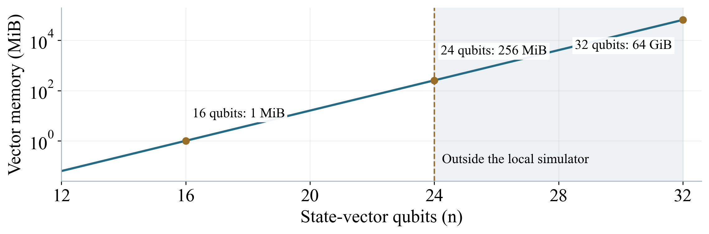

# C Ket: Quantum Programming in C

<!-- authors -->
**Ignacio Schwindt**

<!-- /authors -->

## Abstract

We present C Ket, an experimental quantum programming system integrated into C11 through a GCC plugin. The system combines integer expressions and coherent control with native classical execution. Its architecture comprises ownership analysis, a JSON intermediate representation, reversible synthesis, and OpenQASM 3 export. Explicit dependency preservation enables the uncomputation of temporary registers and distinguishes ownership transfer, borrowing, and measurement. The evaluation comprises 354 native tests, 426 checks across 16 programs, 145 differential compilations, 24 circuits synthesized without tables, and 11 independent validations with QuEST. We analyze gate counts and auxiliary registers for six operators with widths from 4 to 16 bits. Circuit representation supports 128 qubits and local simulation up to 24. The results characterize the implementation and show that auxiliary costs limit the simulation of circuits that can nonetheless be synthesized.

## 1 Introduction

Expressing a quantum algorithm requires coordinating reversible transformations, probabilistic results, and classical computation. Familiar expressions in a general-purpose language do not automatically preserve these properties: overwriting an input or discarding a temporary value may destroy information needed to invert a computation. Measurement also changes the state and must have an explicit place in the program.

C Ket explores this integration within C11 [1]. The programmer declares data with `quant` and uses integer expressions and familiar control constructs, while GCC continues to compile CPU computation. A plugin analyzes the quantum subset before the compiler's general transformations and translates it into verified operations. The native path links a C engine; another path emits static circuits and resources. This organization supports a joint study of semantics, compilation, and representation costs.

The contributions of this work are an ownership and uncomputation discipline integrated into C, a common engine for simulation and export, and an evaluation of arithmetic synthesis without domain enumeration in the studied workloads. The integration covers a subset of C11: quantum operations require reversibility and dependency preservation conditions that classical semantics alone does not establish.

The analysis focuses on the relationship between expressiveness, information preservation, and synthesis cost. In particular, we study how reversible computation dependencies constrain auxiliary reuse and how that reuse affects circuit resources. The evaluation combines functional tests, comparison with an independent simulator, and logical resource measurements.

## 2 Background

Bennett established a framework for recovering space through reversible computation and restoration of auxiliary registers [3]. Silq connects types with safe uncomputation in a high-level quantum language [6]; Quipper supports programmatic circuit composition through a functional approach [7]. C Ket studies these questions through integration with GCC's abstract syntax tree and C's classical control. These works contextualize the design decisions; the evaluation focuses on the implementation and its resources, without an experimental comparison between languages.

OpenQASM 3 provides an interchange language with controls and phases [8, 9]. C Ket exports a static subset whose expressiveness depends on the constructs the frontend can translate. QuEST provides an independent implementation for comparing the states and channels of exported circuits [10].

## 3 System Architecture

Figure 1 separates compilation and execution paths. The plugin is written in C++17, and the runtime and engine in C. Both paths use the same verifier and synthesizer, although external QASM validation uses an independent implementation [1].


### 3.1 Frontend and Types

The `quant` declaration is implemented through a GCC attribute. The plugin intervenes at `PLUGIN_PRE_GENERICIZE` to analyze declarations, expressions, and lifetimes [2]. Integers preserve their width, signed or unsigned interpretation, and explicit conversions. Unsigned arithmetic uses modular reduction; signed expressions must satisfy their validity conditions. The following program illustrates computation and measurement of the value 12:

```c
#include <quantum.h>
#include <stdio.h>
int main(void) {
    quant uint8_t value = 7;
    value += 5;
    printf("%u\n", (unsigned)measure(value));
    return 0;
}
```

### 3.2 Ownership and Uncomputation

Direct initialization between compatible registers transfers ownership; a new expression preserves its inputs and produces a correlated result. Borrowing allows operations without transferring the register. Conceptually, reversible computation accumulates a function in a destination:

$$
U_f|x\rangle|y\rangle=|x\rangle|y\oplus f(x)\rangle.
$$


The `qcompute` operation records the expression, normalized controls, and dependency versions. Its inverse, `quncompute`, requires those elements to remain compatible. Modifying, measuring, or releasing a dependency may prevent uncomputation. Expression identity is determined conservatively from its JSON representation. Before reusing an auxiliary register, the simulator requires residual probability outside the zero state below `1e-10`. Temporary registers are released in reverse dependency order [1, 3].

### 3.3 Coherent Control and Transforms

A quantum condition controls unitary operations. In the following example, Fourier on one bit is equivalent to H, and the controlled XOR creates the Bell state in Figure 3. Subsequent measurements preserve its correlation.

```c
quant bool a = 0, b = 0;
fourier(a);
if (a) b ^= 1;
unsigned first = measure(a), second = measure(b);
```


Quantum control rejects I/O, CPU side effects, measurement, and reset. Fourier uses a positive exponent, little-endian ordering, and synthesis quadratic in register width; its inverse changes the sign. CPU loops remain classical. Export expands accepted fixed forms up to 4096 iterations; quantum declarations in dynamic loops and general coherent loops remain restricted.

### 3.4 Verified IR and Synthesis

`cket.qir`, version 1, is a custom JSON IR. The verifier checks fields, types, arities, conversions, controls, and register availability. It is not LLVM QIR. This isolated instruction computes an 8-bit addition; it requires existing registers and a clean destination [1]:

```json
{"op": "qcompute", "id": 1, "expr": {
  "op": "add", "bits": 8, "signed": false, "args": [
    {"op": "reg", "id": 0, "bits": 8, "signed": false},
    {"op": "const", "bits": 8, "signed": false, "value": 5}
  ]}}
```

The engine combines symbolic synthesis, arithmetic circuits with reversible auxiliary registers, and finite enumeration of up to 12 relevant bits. The `--no-tables` option supports evaluation of synthesis without enumeration. Division and remainder require a proven nonzero divisor. Resource limits determine when an expression is rejected. During native execution, a circuit may be synthesized on its first invocation and reused through a cache.

### 3.5 Search and Amplification

Grover's algorithm reduces oracle queries in unstructured search [4]. C Ket synthesizes the oracle from a pure predicate. The `find` operation requires a unique solution; `find_known` uses a solution count M supplied as a precondition. Both operations require an unmodified uniform preparation and transfer ownership of the input register [1].

```c
quant uint8_t x = superposition(0, 15);
quant uint8_t answer = find(x, x * x == 9);
printf("%u\n", (unsigned)measure(answer));
```

For N candidates and M solutions, the ideal probability after r iterations is [5]:

$$
\theta=\arcsin\sqrt{M/N},\qquad P_r=\sin^2((2r+1)\theta).
$$


The example returns 3 with ideal probability near 96.13%. When the solution count is unknown, `search` combines sampling, amplification, measurement, and classical verification. A false result indicates that the search budget was exhausted. The failure bound specified for this operation, `(7/8)^attempts`, assumes an existing solution and independent uniform randomness; its scope is limited to those execution conditions [1, 5].

## 4 Motivation and Model Costs

Integration with C retains CPU computation and allows quantum resources to be concentrated in registers and oracles. Explicit ownership avoids resolving discarded values through hidden measurements; restoring auxiliaries reduces new allocations. These choices have costs: preserving inputs, building destinations, and reversing computation increases gates and workspace. A high-level expression alone does not determine physical cost.

The simulator uses `double complex` amplitudes and evolves unitarily until a Born-rule measurement. In the reference representation, the vector occupies:

$$
B(n)=16\cdot 2^n\ \mathrm{bytes}.
$$



<!-- table: Table 1. Prototype capabilities: type width, circuit representation, and simulation have distinct limits. -->
| Capability | Limit |
|---|---|
| Quantum integer | 64 representation bits |
| Stored and exported circuit | 128 represented qubits |
| Local state vector | 24 physical qubits |

Auxiliary qubits contribute to state-vector size. An initial distribution with few states of nonzero amplitude retains the dimension associated with the declared width. Reusing restored qubits likewise does not reduce a dimension already reached. Circuit representation and export capacity must therefore be distinguished from the capacity to simulate amplitudes.

## 5 Experimental Setup

### 5.1 Implementation and Environment

The evaluation concerns C Ket 0.4.0 [1], compiled with GCC 11.4.0 on Ubuntu 22.04 under WSL2 x86_64. All campaigns use the same implementation revision. Functional correctness, agreement with an independent implementation, and logical costs of synthesized circuits are assessed separately.

### 5.2 Workloads and Criteria

Frontend and program tests use five optimization levels: `-O0`, `-O1`, `-O2`, `-O3`, and `-Os`. Seeds are fixed at 20261011 for generation and 7 for execution. Resource evaluation covers six operators and four widths, with two uniformly prepared unsigned inputs and a result register. For division and remainder, the divisor is combined by OR with one to exclude zero. Counts include preparation and uncomputation of private auxiliaries; the final result is retained.

## 6 Results

### 6.1 Observed Correctness and External Validation

Table 2 presents validation results according to each campaign's unit. The 145 compilations correspond to 29 cases evaluated at five optimization levels. Native tests include sets of 1024 generated expressions and 4096 intermediate-representation mutations, counted within aggregate cases [1]. These quantities describe different dimensions of the evaluation and are interpreted separately.

<!-- table: Table 2. Validation results for the evaluated implementation. All campaigns completed without failures in the examined cases. -->
| Campaign | Result | Scope |
|---|---|---|
| Native | 354 tests | Semantics, states, errors, and CLI |
| Examples | 426 checks | 16 programs, five levels |
| Differential frontend | 145 compilations | Fixed and generated cases |
| Synthesis without tables | 24 circuits | Six operators, four widths |
| QASM with QuEST | 11 circuits | Eight states and three channels |

An independent reader executes exported circuits in QuEST 3.7.0 [10]. Eight cases compare amplitudes up to a common global phase and probabilities with tolerance `1e-10`. Three channels with intermediate measurement and reset compare outcome sequences through 8192 executions per circuit and implementation. Rejection of eight malformed circuits is also checked. The reader implements the OpenQASM subset used by the exporter.

### 6.2 Logical Gates


<!-- table: Table 3. Logical gate counts by operator and width w of each input register. -->
| Operator | w=4 | w=8 | w=12 | w=16 |
|---|---|---|---|---|
| Addition | 40 | 112 | 216 | 352 |
| Subtraction | 40 | 112 | 216 | 352 |
| Multiplication | 52 | 264 | 764 | 1680 |
| Division | 316 | 1432 | 3732 | 7600 |
| Remainder | 324 | 1448 | 3756 | 7632 |
| Less than | 49 | 97 | 145 | 193 |

At 16 bits, comparison requires 193 gates and remainder 7632. Each MCX counts as one logical gate before decomposition. Counts describe relative synthesizer costs; they exclude execution times and physical decomposition.

### 6.3 Auxiliary Registers and Depth


<!-- table: Table 4. Logical resources for w=16. Auxiliaries and peak are expressed in qubits; depth reflects circuit dependencies before physical mapping. -->
| Operator | Gates | Auxiliaries | Peak qubits | Logical depth |
|---|---|---|---|---|
| Addition | 352 | 16 | 64 | 246 |
| Subtraction | 352 | 16 | 64 | 276 |
| Multiplication | 1680 | 16 | 64 | 1634 |
| Division | 7600 | 50 | 98 | 5538 |
| Remainder | 7632 | 66 | 114 | 5540 |
| Less than | 193 | 17 | 50 | 41 |

The two inputs and result of addition, subtraction, and multiplication occupy 48 qubits; auxiliaries raise the peak to 64. Remainder reaches 114. Circuits with 50 to 114 qubits are analyzed through synthesis and accounting. Depth measures logical dependencies. Its difference between addition and subtraction, despite equal gate counts, reflects differences in parallelism.

With 8, 16, 24, and 32 relevant bits, the workloads exceed the 12-bit enumeration limit. Representing 64-bit integers does not guarantee synthesis within the available budget: division at that width requires more auxiliaries than supported.

### 6.4 Threats to Validity and Restrictions

The evaluation uses one GCC version and finite workloads. Simulation employs floating point without a global bound on accumulated error. Sharing the execution and export engine may correlate errors. QuEST reduces this dependence in the compared cases, without constituting a formal proof.

Flow analysis does not cover every C path. Recursion, indirect calls, composition across translation units, and product returns are restricted. General quantum floating-point values, VLAs, unions, bitfields, and quantum dynamic allocation are unsupported. Unitary modules require typed borrows and restored auxiliaries, without constituting a general ABI.

The study considers ideal circuits, without quantum processor execution, noise, error correction, or physical connectivity. Complete amplitude access supports simulation validation and is not a hardware operation [1].

<!-- page -->

## 7 Conclusions

C Ket integrates quantum declarations, reversible computation, and classical control within a subset of C11. Ownership discipline and dependency preservation enable restoration of temporary registers, while a shared engine connects hybrid execution with circuit export. Functional validation and independent comparison provide evidence of agreement within the evaluated workloads.

The resource analysis shows that operator expressiveness must be assessed together with auxiliary requirements. Division and remainder incur the highest costs among the studied families, and several synthesizable circuits exceed simulator capacity. Distinguishing representation, synthesis, and simulation is therefore essential to interpreting the system's scope.

The long-term objective is explicit quantum semantics for all C11 constructs and standard-library interfaces. Future work therefore distinguishes missing implementations, resource bounds, and justified semantic incompatibilities. Flow analysis, memory, numeric types, and cross-unit composition require staged validation. GCC stability, physical decomposition, and comparisons using equivalent workloads and execution times would complement the logical resources presented here.


## References

[1] Schwindt, I. *C Ket: C with high-level quantum data*. Version 0.4.0, 2026. [Software](https://github.com/igna-s/cket).

[2] Free Software Foundation. *GNU Compiler Collection Internals: Plugin API*. Official documentation, accessed October 11, 2026. [GCC plugin API](https://gcc.gnu.org/onlinedocs/gccint/Plugin-API.html).

[3] Bennett, C. H. Logical Reversibility of Computation. *IBM Journal of Research and Development*, 17(6):525-532, 1973. DOI: 10.1147/rd.176.0525. [Original article](https://doi.org/10.1147/rd.176.0525).

[4] Grover, L. K. A fast quantum mechanical algorithm for database search. *STOC*, pp. 212-219, 1996. arXiv:quant-ph/9605043. [Preprint](https://arxiv.org/abs/quant-ph/9605043).

[5] Boyer, M., Brassard, G., Høyer, P., and Tapp, A. Tight bounds on quantum searching. *Fortschritte der Physik*, 46, 1998; preprint 1996. arXiv:quant-ph/9605034. [Preprint](https://arxiv.org/abs/quant-ph/9605034).

[6] Bichsel, B., Baader, M., Gehr, T., and Vechev, M. Silq: A High-Level Quantum Language with Safe Uncomputation and Intuitive Semantics. *PLDI*, pp. 286-300, 2020. DOI: 10.1145/3385412.3386007. [Extended authors' version](https://files.sri.inf.ethz.ch/website/papers/pldi20-silq.pdf).

[7] Green, A. S., Lumsdaine, P. L., Ross, N. J., Selinger, P., and Valiron, B. Quipper: A Scalable Quantum Programming Language. *ACM SIGPLAN Notices*, 48(6):333-342, 2013. [Preprint](https://arxiv.org/abs/1304.3390).

[8] Cross, A. W., et al. OpenQASM 3: A broader and deeper quantum assembly language. *ACM Transactions on Quantum Computing*, 3(3), 2022. DOI: 10.1145/3505636. [Preprint](https://arxiv.org/abs/2104.14722).

[9] OpenQASM. *OpenQASM 3.0 Specification: Gates*. Official specification, accessed October 11, 2026. [Controls and phases](https://openqasm.com/versions/3.0/language/gates.html).

[10] Jones, T., Brown, A., Bush, I., and Benjamin, S. C. QuEST and High Performance Simulation of Quantum Computers. *Scientific Reports*, 9:10736, 2019. DOI: 10.1038/s41598-019-47174-9. [Preprint](https://arxiv.org/abs/1802.08032).
