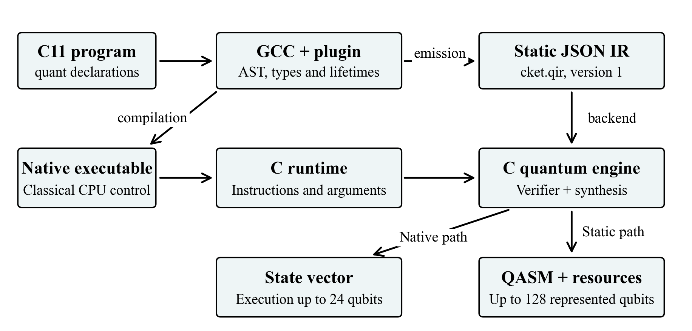
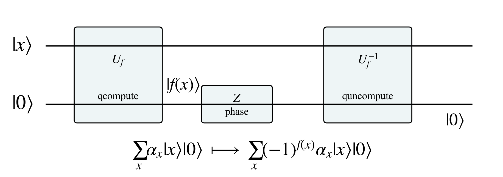
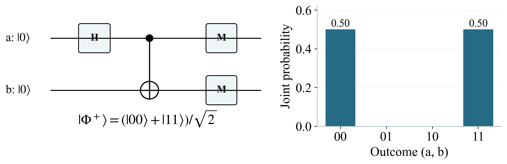
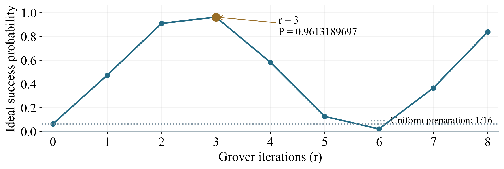
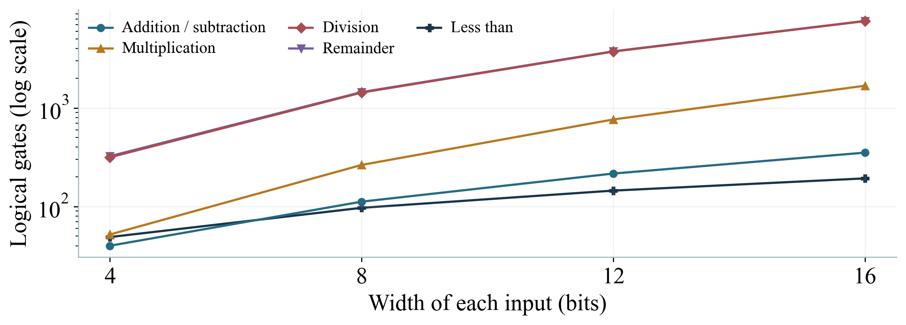
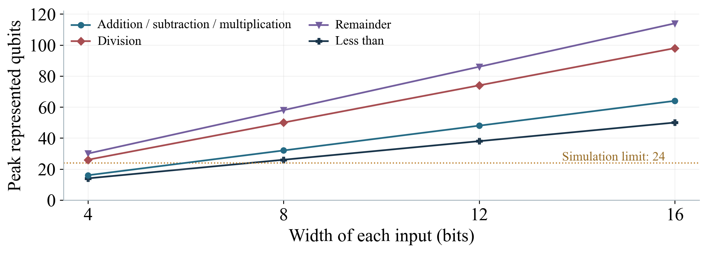

# C Ket: Quantum Programming in C

<!-- authors -->
**Ignacio Schwindt**

C Ket project (|c> / cket)
<!-- /authors -->

## Abstract

C Ket is a prototype for high-level quantum programming integrated into C11 through a GCC plugin. It supports quantum integer declarations, computations and coherent conditions, and combines circuits with native classical control. Its architecture brings together a frontend with ownership analysis, a verified JSON intermediate representation, reversible synthesis, a C runtime, and OpenQASM 3 export. The system requires preservation of the dependencies needed to uncompute temporary registers and distinguishes ownership transfer, borrowing, and measurement. We evaluate a fixed revision through 354 native tests, 426 checks across 16 examples, 145 differential compilations, 24 circuits synthesized without tables, and 11 independent validations with QuEST. We report gate and workspace costs for six operators from 4 to 16 bits. The representation supports 128 qubits, whereas the local simulator supports 24; these are distinct capabilities. The results document the implemented subset and its limits without claiming practical advantage, hardware execution, or general formal correctness.

## 1 Introduction

Expressing a quantum algorithm requires coordinating reversible transformations, probabilistic results, and classical computation. Familiar expressions in a general-purpose language do not automatically preserve these properties: overwriting an input or discarding a temporary value may destroy information needed to invert a computation. Measurement also changes the state and must have an explicit place in the program.

C Ket explores this integration within C11 [1]. The programmer declares data with `quant` and uses integer expressions and familiar control constructs, while GCC continues to compile CPU computation. A plugin analyzes the quantum subset before the compiler's general transformations and translates it into verified operations. The native path links a C engine; another path emits static circuits and resources. This organization supports a joint study of semantics, compilation, and representation costs.

The project's contribution has three parts: an explicit discipline for ownership and uncomputation; an engine shared by simulation and export; and reproducible evidence of acceptance, rejection, and arithmetic synthesis without domain enumeration in the evaluated workloads. Its scope is experimental. C Ket does not implement all of C11 for quantum data, and retaining C syntax does not guarantee that every classical program has a coherent translation.

The article presents background, architecture, and the motivation for the model, followed by the experimental setup, results, and qualified conclusions. Figures distinguish diagrams, ideal calculations, and synthesis data. The evaluation concerns cket 0.4.0 and the revision identified in Section 5, avoiding a mixture of measurements from different project states.

<!-- page -->

## 2 Background

Bennett established a framework for recovering space through reversible computation and restoration of auxiliary registers [3]. Silq connects types with safe uncomputation in a high-level quantum language [6]; Quipper supports programmatic circuit composition through a functional approach [7]. C Ket follows this line of work and investigates integration with GCC's AST and C's classical control. The comparison is architectural: equivalent productivity or performance was not measured against those languages.

OpenQASM 3 provides an interchange language with controls and phases [8, 9]. C Ket exports a static subset; its restrictions on CPU operations are not general restrictions of the standard. QuEST provides an external implementation for checking exported circuits [10]. These components serve different roles: frontend, interchange, and simulation reference.

## 3 System Architecture

Figure 1 separates compilation and execution paths. The plugin is written in C++17, and the runtime and engine in C. Both paths use the same verifier and synthesizer, although external QASM validation uses an independent implementation [1].



### 3.1 Frontend and Types

`quant` is a GCC attribute macro, not a separate parser. The plugin uses `PLUGIN_PRE_GENERICIZE` to inspect declarations, expressions, and lifetimes [2]. Integers preserve width, signedness, and explicit conversions. Unsigned arithmetic follows modular reduction; signed expressions remain subject to their validity conditions. The following complete program computes and measures 12:

```c
#include <quantum.h>
#include <stdio.h>
int main(void) {
    quant uint8_t value = 7;
    value += 5;
    printf("%u\n", (unsigned)measure(value));
    return 0;
}
```

<!-- page -->

### 3.2 Ownership and Uncomputation

Direct initialization between compatible registers transfers ownership; a new expression preserves its inputs and produces a correlated result. Borrowing allows operations without transferring the register. Conceptually, reversible computation accumulates a function in a destination:

$$
U_f|x\rangle|y\rangle=|x\rangle|y\oplus f(x)\rangle.
$$



Each `qcompute` certifies a JSON expression, normalized controls, and dependency versions. `quncompute` requires compatibility; mutating, measuring, or freeing a dependency may invalidate the inverse. Textual JSON equality is conservative and does not decide general mathematical equivalence. Simulation requires residual probability outside zero below `1e-10` before auxiliary storage can be reused. Eligible cleanup follows reverse dependency order [1, 3].

### 3.3 Coherent Control and Transforms

A quantum condition controls unitary operations. In the following example, Fourier on one bit is equivalent to H, and the controlled XOR creates the Bell state in Figure 3. Subsequent measurements preserve its correlation.

```c
quant bool a = 0, b = 0;
fourier(a);
if (a) b ^= 1;
unsigned first = measure(a), second = measure(b);
```



Quantum control rejects I/O, CPU side effects, measurement, and reset. Fourier uses a positive exponent, little-endian ordering, and synthesis quadratic in register width; its inverse changes the sign. CPU loops remain classical. Export expands accepted fixed forms up to 4096 iterations; quantum declarations in dynamic loops and general coherent loops remain restricted.

<!-- page -->

### 3.4 Verified IR and Synthesis

`cket.qir`, version 1, is a custom JSON IR. The verifier checks fields, types, arities, conversions, controls, and register availability. It is not LLVM QIR. This isolated instruction computes an 8-bit addition; it requires existing registers and a clean destination [1]:

```json
{"op": "qcompute", "id": 1, "expr": {
  "op": "add", "bits": 8, "signed": false, "args": [
    {"op": "reg", "id": 0, "bits": 8, "signed": false},
    {"op": "const", "bits": 8, "signed": false, "value": 5}
  ]}}
```

The engine combines symbolic synthesis, arithmetic circuits with reversible workspace, and a finite fallback for up to 12 relevant bits. `--no-tables` disables that fallback. Division and remainder require a proven nonzero divisor. Resource budgets produce diagnostics without ensuring efficient synthesis for every expression. In the native path, a first call may synthesize a circuit and populate a cache; this does not imply general ahead-of-time compilation.

### 3.5 Search and Amplification

Grover reduces oracle queries for unstructured search [4]. C Ket constructs the oracle from a pure predicate; its synthesis also has a cost. `find` requires one solution, while `find_known` takes a count M promised by the caller. Both operations require intact uniform preparation and transfer ownership [1].

```c
quant uint8_t x = superposition(0, 15);
quant uint8_t answer = find(x, x * x == 9);
printf("%u\n", (unsigned)measure(answer));
```

For N candidates and M solutions, the ideal probability after r iterations is [5]:

$$
\theta=\arcsin\sqrt{M/N},\qquad P_r=\sin^2((2r+1)\theta).
$$



The example returns 3 with ideal probability near 96.13%, without a deterministic guarantee. For an unknown count, `search` mixes sampling and Grover with measurement and classical verification; false means the budget was exhausted. Its documented bound `(7/8)^attempts` assumes an existing solution and independent uniform randomness. This is a project contract, not a new theorem or a literal attribution to BBHT [1, 5].

<!-- page -->

## 4 Motivation and Model Costs

Integration with C retains CPU computation and allows quantum resources to be concentrated in registers and oracles. Explicit ownership avoids resolving discarded values through hidden measurements; restoring auxiliaries reduces new allocations. These choices have costs: preserving inputs, building destinations, and reversing computation increases gates and workspace. A high-level expression alone does not determine physical cost.

The simulator uses `double complex` amplitudes and evolves unitarily until a Born-rule measurement. In the reference representation, the vector occupies:

$$
B(n)=16\cdot 2^n\ \mathrm{bytes}.
$$


<!-- table: Table 1. Prototype capabilities: type width, circuit representation, and simulation have distinct limits. -->
| Capability | Limit |
|---|---|
| Quantum integer | 64 representation bits |
| Stored and exported circuit | 128 represented qubits |
| Local state vector | 24 physical qubits |

Auxiliaries count toward simulation. A small initial support does not remove bits from the declared width; reusing clean wires also does not shrink a vector dimension already reached. Exporting a large circuit does not imply simulating it or executing it on a QPU.

## 5 Experimental Setup

### 5.1 Revision and Environment

We evaluate commit `1ebb2e308e61bed5632798ded5beecf77b6b9a9c`, experimental cket 0.4.0, with GCC 11.4.0 on Ubuntu 22.04, WSL2 x86_64. Logs, CSV data, and states are preserved in `docs/paper/evidence/`. The study's campaigns were rerun at that state; this edition reuses that evidence and rechecks the manuscript's examples.

### 5.2 Workloads and Criteria

Frontend and example tests use five levels: `-O0`, `-O1`, `-O2`, `-O3`, and `-Os`; seeds are 20261011 for generation and 7 for execution. The benchmark studies six operators and four widths with two uniformly prepared unsigned inputs and a destination. Division and remainder apply OR with one to the divisor to exclude zero. Preparation and private cleanup are included, while the final result is retained.

<!-- page -->

## 6 Results

### 6.1 Observed Correctness and External Validation

Table 2 summarizes campaigns with different units; their counts are not added as homogeneous coverage. The 145 compilations represent 29 cases at five levels, not 145 algorithms. Internal campaigns of 1024 expressions and 4096 mutations belong to aggregate native-suite cases [1].

<!-- table: Table 2. Campaigns for the fixed revision. All passed; each row retains its own unit of validation. -->
| Campaign | Result | Scope |
|---|---|---|
| Native | 354 tests | Semantics, states, errors, and CLI |
| Examples | 426 checks | 16 programs, five levels |
| Differential frontend | 145 compilations | Fixed and generated cases |
| Synthesis without tables | 24 circuits | Six operators, four widths |
| QASM with QuEST | 11 circuits | Eight states and three channels |

A separate importer executes QASM in QuEST 3.7.0 [10]. Eight cases compare amplitudes up to global phase and probabilities with tolerance `1e-10`; three channels compare transcripts with 8192 executions per circuit and implementation. Eight malformed artifacts are also rejected. The importer covers the emitted subset, not all of OpenQASM 3.

### 6.2 Logical Gates



<!-- table: Table 3. Logical gates by operator and width w of each input, checked against the CSV. -->
| Operator | w=4 | w=8 | w=12 | w=16 |
|---|---|---|---|---|
| Addition | 40 | 112 | 216 | 352 |
| Subtraction | 40 | 112 | 216 | 352 |
| Multiplication | 52 | 264 | 764 | 1680 |
| Division | 316 | 1432 | 3732 | 7600 |
| Remainder | 324 | 1448 | 3756 | 7632 |
| Less than | 49 | 97 | 145 | 193 |

At 16 bits, comparison uses 193 gates and remainder 7632. Each MCX counts as one logical gate before decomposition. The data do not prove optimality, general complexity, or speedup. Wall-clock times were not measured.

<!-- page -->

### 6.3 Workspace and Depth



<!-- table: Table 4. Resources at w=16. Auxiliaries and peak are qubits; depth measures logical wire dependencies before physical mapping. -->
| Operator | Gates | Auxiliaries | Peak qubits | Logical depth |
|---|---|---|---|---|
| Addition | 352 | 16 | 64 | 246 |
| Subtraction | 352 | 16 | 64 | 276 |
| Multiplication | 1680 | 16 | 64 | 1634 |
| Division | 7600 | 50 | 98 | 5538 |
| Remainder | 7632 | 66 | 114 | 5540 |
| Less than | 193 | 17 | 50 | 41 |

For addition, subtraction, and multiplication, two inputs and a result contribute 48 logical qubits; the total peak is 64. Remainder reaches 114. Points from 50 to 114 qubits come from synthesis and resource accounting, not amplitude simulation. Depth is not physical duration, T-depth, or transpiled depth. Addition and subtraction have equal gate counts but different depths: total gates alone do not describe parallelism.

The studied widths imply 8, 16, 24, and 32 relevant input bits. Construction without tables demonstrates that these accepted families exceed the 12-bit fallback. It does not establish universal 64-bit support; division at that width requires additional workspace that is not yet supported.

### 6.4 Threats to Validity and Restrictions

The evaluation covers one GCC environment, finite programs, and floating-point precision without a global error budget. Sharing an engine across paths may correlate failures; QuEST reduces this dependence for the checked cases. The internal `volatile` marker helps preserve accesses under optimization, but its tests do not constitute a formal proof.

Flow and lifetime analysis does not model every C path. Restrictions remain on recursion, indirect calls, quantum composition across translation units, and product returns. General quantum floating-point values, VLAs, unions, bitfields, and quantum dynamic allocation are unsupported. The unitary `circuit` and `inverse_circuit` modules remap typed borrows and require clean private auxiliaries; they do not complete a general quantum C ABI.

The prototype has no QPU, noise, error correction, or topology mapping. `--state` is a simulator tool, with no equivalent as unrestricted hardware observation. No result certifies the open goals of version 1.0 [1].

<!-- page -->

## 7 Conclusions

C Ket implements an experimental path from quantum data in C11 to hybrid execution and verified circuits. Its ownership and dependency contracts allow temporary uncomputation within the accepted subset. The evaluation reproduces observed correctness and export, and quantifies gates and workspace for six families without tables. Division and remainder are especially demanding; several constructible circuits exceed the simulator's capacity. These findings establish neither practical advantage nor general correctness.

Next steps include extending flow analysis and the ABI, comparing GCC versions, and measuring costs after decomposition and execution times for equivalent workloads. Article source, figures, data, and audit accompany the checkout. To repeat the fixed-revision evaluation on Linux or WSL:

```bash
export CC=gcc-11 CXX=g++-11
bash docs/paper/audit_project.sh
```

**Availability.** The MIT-licensed code credits Ignacio Schwindt and contributors. The repository identified by the project is private; evaluation used the local checkout [1].

## References

[1] Schwindt, I., and contributors. *|c> / cket: C with high-level quantum data*. Experimental version 0.4.0, revision `1ebb2e3`, 2026. Code and documentation consulted locally; evidence in `docs/paper/evidence/`. [Project repository](https://github.com/igna-s/cket).

[2] Free Software Foundation. *GNU Compiler Collection Internals: Plugin API*. Official documentation, accessed October 11, 2026. [GCC plugin API](https://gcc.gnu.org/onlinedocs/gccint/Plugin-API.html).

[3] Bennett, C. H. Logical Reversibility of Computation. *IBM Journal of Research and Development*, 17(6):525-532, 1973. DOI: 10.1147/rd.176.0525. [Original article](https://doi.org/10.1147/rd.176.0525).

[4] Grover, L. K. A fast quantum mechanical algorithm for database search. *STOC*, pp. 212-219, 1996. arXiv:quant-ph/9605043. [Preprint](https://arxiv.org/abs/quant-ph/9605043).

[5] Boyer, M., Brassard, G., Høyer, P., and Tapp, A. Tight bounds on quantum searching. *Fortschritte der Physik*, 46, 1998; preprint 1996. arXiv:quant-ph/9605034. [Preprint](https://arxiv.org/abs/quant-ph/9605034).

[6] Bichsel, B., Baader, M., Gehr, T., and Vechev, M. Silq: A High-Level Quantum Language with Safe Uncomputation and Intuitive Semantics. *PLDI*, pp. 286-300, 2020. DOI: 10.1145/3385412.3386007. [Extended authors' version](https://files.sri.inf.ethz.ch/website/papers/pldi20-silq.pdf).

[7] Green, A. S., Lumsdaine, P. L., Ross, N. J., Selinger, P., and Valiron, B. Quipper: A Scalable Quantum Programming Language. *ACM SIGPLAN Notices*, 48(6):333-342, 2013. [Preprint](https://arxiv.org/abs/1304.3390).

[8] Cross, A. W., et al. OpenQASM 3: A broader and deeper quantum assembly language. *ACM Transactions on Quantum Computing*, 3(3), 2022. DOI: 10.1145/3505636. [Preprint](https://arxiv.org/abs/2104.14722).

[9] OpenQASM. *OpenQASM 3.0 Specification: Gates*. Official specification, accessed October 11, 2026. [Controls and phases](https://openqasm.com/versions/3.0/language/gates.html).

[10] Jones, T., Brown, A., Bush, I., and Benjamin, S. C. QuEST and High Performance Simulation of Quantum Computers. *Scientific Reports*, 9:10736, 2019. DOI: 10.1038/s41598-019-47174-9. [Preprint](https://arxiv.org/abs/1802.08032).

